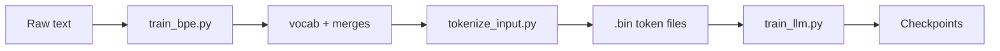

# Getting Started: End-to-End Training Pipeline

This guide walks through the full workflow for training a language model on TinyStories — from BPE training through tokenization to LLM training.



---

## 1. Generate token sequence frequency files

First, generate the frequency `.pkl` files so you don't need to regenerate them on every run.

```sh
uv run train_bpe.py \
  --input-path=data/TinyStoriesV2-GPT4-train.txt \
  --vocab-size=10000 \
  --num-workers=8 \
  --num-splits=32
```

To save the sequence frequency file for reuse, pass an output path:

```sh
--sequence-freq-output-path=freq_ts.pkl
```

This lets you skip the multi-processing stage (the most time-consuming part) on subsequent runs.

### Benchmarks: BPE training

| Hardware | Pre-tokenization | Merging | Total training | Notes |
|----------|------------------|---------|----------------|-------|
| M1 CPU | 71 s | 47 s | 118 s | 59,933 seq entries; 9,743 merges |
| M4 CPU (2024) | — | 28 s | 67 s | Largest chunk: 66.4 MB in 9.9 s |

<details>
<summary>M1 CPU — full log</summary>

```
sequence_freq dict has 59933 entries
pair_to_seqs dict has 2108 entries
pair_freq dict has 2108 entries
Pre-tokenization took 71 seconds
To perform 9743 merges
Iteration 0, time elapsed: 0 s, merging: b' ' + b't'
Iteration 1000, time elapsed: 3 s, merging: b' c' + b'ut'
Iteration 2000, time elapsed: 4 s, merging: b' v' + b'al'
Iteration 3000, time elapsed: 4 s, merging: b' qu' + b'ar'
Iteration 4000, time elapsed: 5 s, merging: b' te' + b'ase'
Iteration 5000, time elapsed: 5 s, merging: b' spoon' + b's'
Iteration 6000, time elapsed: 5 s, merging: b' tim' + b'er'
Iteration 7000, time elapsed: 5 s, merging: b' L' + b'izzie'
Iteration 8000, time elapsed: 6 s, merging: b' invit' + b'ations'
Iteration 9000, time elapsed: 6 s, merging: b' sc' + b'ulpture'
Merging took 47 seconds
Training took 118 seconds
Vocab size: 10000
Number of merges: 9743
Vocab and merges saved to vocab_ts.pkl and merges_ts.pkl
```

</details>

---

## 2. Tokenize input text

Tokenize the training and validation datasets into binary token integer files. The model trainer can then load encoded tokens directly instead of raw text.

**Training set:**

```sh
uv run tokenize_input.py \
  --input-path=data/TinyStoriesV2-GPT4-train.txt \
  --output-path=data/TinyStoriesV2-GPT4-train.bin \
  --vocab-path=vocab_ts.pkl \
  --merges-path=merges_ts.pkl \
  --num-splits=64 \
  --num-workers=8
```

**Validation set:**

```sh
uv run tokenize_input.py \
  --input-path=data/TinyStoriesV2-GPT4-valid.txt \
  --output-path=data/TinyStoriesV2-GPT4-valid.bin \
  --vocab-path=vocab_ts.pkl \
  --merges-path=merges_ts.pkl \
  --num-splits=1 \
  --num-workers=1
```

### Benchmarks: tokenization

| Hardware | Result |
|----------|--------|
| M1 CPU | _TODO_ |
| M4 CPU | 8,457,751 tokens · 33 MB · 36.3 s |

---

## 3. Train the model

Start training with the config in [`configs/train_llm_ts.toml`](./configs/train_llm_ts.toml):

```sh
uv run train_llm.py \
  --dataset-name=TinyStoriesV2-GPT4 \
  --vocab-path=vocab_ts.pkl \
  --merges-path=merges_ts.pkl \
  --config-path=configs/train_llm_ts.toml \
  --num-steps=5000 \
  --wandb-log-interval=50 \
  --print-interval=100 \
  --eval-interval=100 \
  --checkpoint-interval=500 \
  --device=mps
```

Training on MPS (Apple GPU) is ~1.5× faster than CPU on M1, and ~2× faster on M4.

### Benchmarks: training throughput

| Device | Tokens/s |
|--------|----------|
| M1 CPU | 2,251.5 |
| M1 GPU (MPS) | 3,127.7 |
| M4 GPU (MPS) | 7,851.7 |

<details>
<summary>M4 GPU — sample run (5,000 steps)</summary>

```
Step 5000: training loss = 1.780, validation loss = 1.718, tokens processed = 819200, time elapsed = 104.3 s,  tokens/s = 7851.7
Trained for 5000 steps, processed 40960000 tokens, total training time: 9367.6 s
```

</details>

For quick smoke testing, Use

```sh
uv run train_llm.py \
  --dataset-name=TinyStoriesV2-GPT4 \
  --vocab-path=vocab_ts.pkl \
  --merges-path=merges_ts.pkl \
  --config-path=configs/train_llm_ts.toml \
  --num-steps=100 \
  --wandb-log-interval=1 \
  --print-interval=10 \
  --eval-interval=20 \
  --checkpoint-interval=50 \
  --device=mps
---

## TODO

- [ ] Finish memory/FLOPs estimates in the assignments
- [ ] Connect to Weights & Biases (wandb)
- [ ] Try the effect of `torch.compile`
- [ ] Try training on OpenWebText (OWT)
- [ ] Refactor code for better organization
- [ ] Understand the difference between `encode_part` and `encode_part_2` and see if we can improve the latter
